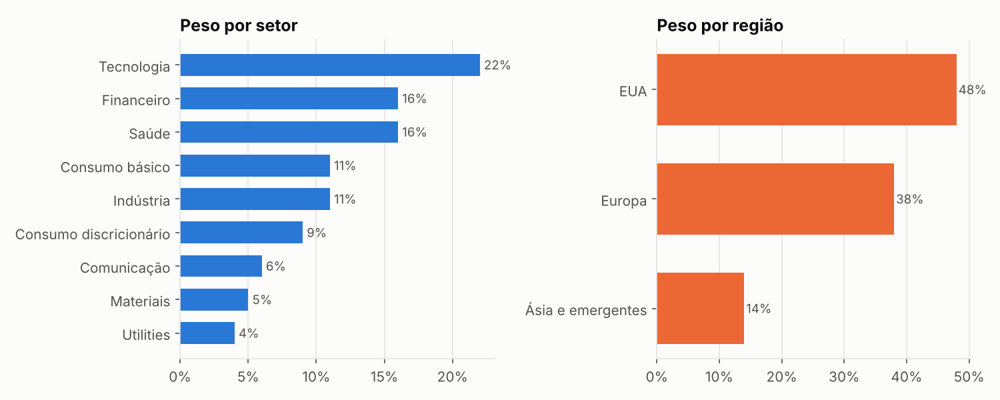
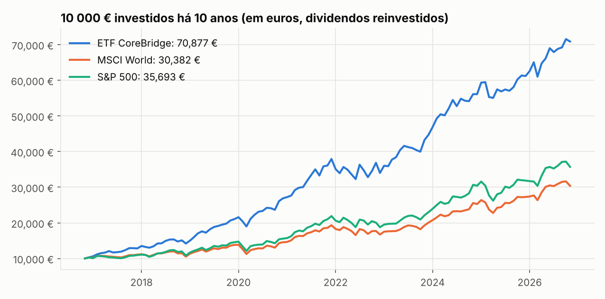
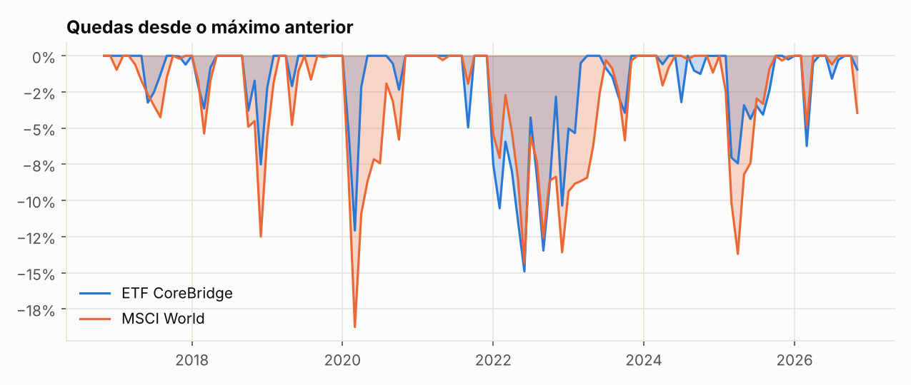
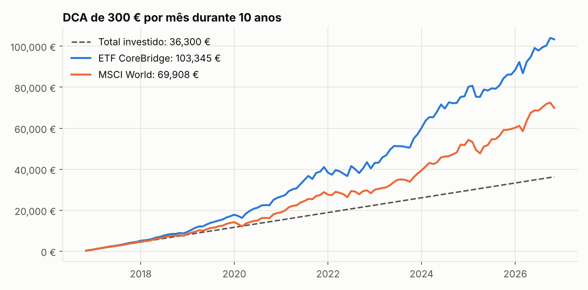

# ETF pessoal CoreBridge: Quality Compounders

Carteira de **25 empresas** de qualidade, com vantagens competitivas duradouras, pensada para investir regularmente (DCA) e manter durante muitos anos. Dados de mercado: Yahoo Finance, até 11/2026, todos os valores em euros.

> ⚠️ Não é aconselhamento financeiro personalizado. O histórico abaixo tem **viés de retrospetiva**: as empresas foram escolhidas hoje, sabendo que correram bem. Os próximos 10 anos dificilmente serão tão bons. Lê a secção [Limitações](#limitações).

## Composição

| Empresa | Ticker | Peso | Setor | Região | Vantagem competitiva | Principal risco |
|---|---|---|---|---|---|---|
| **Microsoft** | MSFT | 6% | Tecnologia | EUA | Azure + Office 365: software crítico com custos de mudança muito altos; distribuição de IA para empresas. | Investimento em IA pode não ter retorno; concorrência da AWS e Google Cloud. |
| **Alphabet** | GOOGL | 6% | Comunicação | EUA | Pesquisa, YouTube, Android e Google Cloud; dados e escala sem igual; TPUs próprios para IA. | Pesquisa ameaçada por assistentes de IA; processos de concorrência (antitrust). |
| **ASML** | ASML.AS | 5% | Tecnologia | Europa | Monopólio mundial em litografia EUV; nenhum concorrente consegue fazer estas máquinas. | Ciclo dos semicondutores e restrições de exportação para a China. |
| **Visa** | V | 5% | Financeiro | EUA | Rede de pagamentos com efeito de rede global; margens operacionais ~65%. | Regulação das comissões; pagamentos instantâneos e stablecoins. |
| **TSMC** | TSM | 5% | Tecnologia | Ásia e emergentes | Fabrica ~90% dos chips mais avançados do mundo; anos de vantagem tecnológica e de escala. | Risco geopolítico Taiwan/China; novas fábricas fora de Taiwan com margens mais baixas. |
| **Schneider Electric** | SU.PA | 5% | Indústria | Europa | Gestão de energia e automação; beneficia da eletrificação e dos centros de dados. | Ciclo de construção e industrial. |
| **Linde** | LIN | 5% | Materiais | EUA | Oligopólio dos gases industriais; contratos de 15-20 anos com cláusulas de inflação. | Ciclo industrial; projetos de hidrogénio com retorno incerto. |
| **Costco** | COST | 5% | Consumo básico | EUA | Modelo de quotas de sócio (renovação >90%) e preços baixos difíceis de igualar. | Avaliação muito alta (P/E > 40). |
| **S&P Global** | SPGI | 4% | Financeiro | EUA | Ratings (duopólio com a Moody's), índices S&P 500 e dados financeiros. | Volume de emissões de dívida é cíclico. |
| **AstraZeneca** | AZN.L | 4% | Saúde | Europa | Pipeline líder em oncologia; crescimento acima do setor. | Pressão de preços nos EUA e na China. |
| **Iberdrola** | IBE.MC | 4% | Utilities | Europa | Maior utility renovável da Europa; redes elétricas reguladas nos EUA, Reino Unido e Espanha. | Sensível às taxas de juro e ao risco regulatório. |
| **Deutsche Börse** | DB1.DE | 4% | Financeiro | Europa | Bolsa alemã, câmara de compensação Eurex e Clearstream; infraestrutura difícil de replicar. | Receitas de juros sobre depósitos de clientes caem se as taxas descerem. |
| **Eli Lilly** | LLY | 4% | Saúde | EUA | Líder em medicamentos para obesidade/diabetes (tirzepatida) com pipeline forte. | Avaliação já descontada; concorrência e pressão nos preços dos medicamentos nos EUA. |
| **Intuitive Surgical** | ISRG | 4% | Saúde | EUA | Líder em cirurgia robótica (da Vinci); base instalada gera receita recorrente de instrumentos. | Concorrência de Medtronic e J&J a chegar ao mercado; avaliação alta. |
| **Novartis** | NOVN.SW | 4% | Saúde | Europa | Farmacêutica focada em medicamentos inovadores; balanço sólido e dividendo crescente. | Fim de patentes (Entresto) e risco de ensaios clínicos. |
| **Cadence Design** | CDNS | 3% | Tecnologia | EUA | Duopólio com a Synopsys no software de desenho de chips; receita recorrente. | Avaliação exigente; dependência do ciclo de investimento em chips. |
| **Keyence** | 6861.T | 3% | Tecnologia | Ásia e emergentes | Sensores e automação fabril com margens operacionais acima de 50% e zero dívida. | Ciclo industrial; crescimento recente mais lento. |
| **Coca-Cola** | KO | 3% | Consumo básico | EUA | Marca e rede de distribuição global; defensiva em recessões; dividendo cresce há 60+ anos. | Crescimento baixo; tendência para menos açúcar. |
| **L'Oréal** | OR.PA | 3% | Consumo básico | Europa | Líder mundial em cosmética, com marcas fortes e distribuição global. | Abrandamento na China; concorrência de marcas digitais. |
| **HDFC Bank** | HDB | 3% | Financeiro | Ásia e emergentes | Maior banco privado da Índia; aposta no crescimento do crédito e da classe média indiana. | Integração da fusão com a HDFC Ltd. pressiona margens; risco cambial (rupia). |
| **Hermès** | RMS.PA | 3% | Consumo discricionário | Europa | Luxo absoluto com escassez deliberada; poder de preço e margens >40%. | Avaliação alta; abrandamento do luxo na China. |
| **MercadoLibre** | MELI | 3% | Consumo discricionário | Ásia e emergentes | Líder em e-commerce e fintech (Mercado Pago) na América Latina; crescimento > 30%. | Volatilidade de moedas latino-americanas; concorrência da Shopee e Temu. |
| **Ferrari** | RACE.MI | 3% | Consumo discricionário | Europa | Marca única, listas de espera de anos e poder de preço; ROE > 40%. | Transição para elétricos; avaliação de marca de luxo. |
| **Waste Management** | WM | 3% | Indústria | EUA | Aterros sanitários são ativos quase impossíveis de licenciar de novo; preços sobem com a inflação. | Crescimento moderado; dívida. |
| **Atlas Copco** | ATCO-A.ST | 3% | Indústria | Europa | Compressores e bombas de vácuo líderes; serviços pós-venda dão receita recorrente. | Ciclo industrial e de semicondutores. |

**Limites de diversificação** (verificados no código): nenhum setor acima de 22%, nenhuma região acima de 50%, nenhuma posição acima de 7%. O ETF MSCI World tem cerca de 70% em ações dos EUA; aqui os EUA pesam 48%. Correlação média entre as ações: 0.28.

## Qualidade dos negócios (média ponderada)

| Indicador | ETF CoreBridge |
|---|---|
| Margem bruta | 61.0% |
| Margem operacional | 34.2% |
| Margem líquida | 27.0% |
| ROE (limitado a 100%) | 32.3% |
| Crescimento de receitas (último ano) | 21.4% |
| Crescimento anual de receitas (histórico, ~3 anos) | 12.2% |
| P/E previsto (média ponderada) | 24.4 |
| Dividend yield (%) | 1.1% |

Para comparação, o MSCI World tem uma margem líquida próxima de 12% e um P/E previsto entre 19 e 20. Paga-se um prémio por empresas com margens e rentabilidade bem acima da média, e é esse o risco principal da carteira: se o crescimento abrandar, os múltiplos podem descer.

## Histórico (10 anos, em euros)

| | ETF CoreBridge | MSCI World (EUNL) | S&P 500 (SXR8) | Sem as 3 melhores |
|---|---|---|---|---|
| CAGR | 21.6% | 11.8% | 13.6% | 19.4% |
| Volatilidade | 13.5% | 13.3% | 14.3% | 13.3% |
| Queda máxima | -14.9% | -18.8% | -17.6% | -15.0% |
| Sharpe | 1.46 | 0.74 | 0.81 | 1.30 |
| Pior ano | -10.4% | -13.6% | -14.3% | -10.4% |
| Melhor ano | 48.2% | 32.7% | 40.7% | 45.9% |

A coluna **Sem as 3 melhores** retira LLY, ASML.AS, TSM (as que mais subiram) e redistribui o peso. Mostra quanto do resultado depende de ter acertado nos maiores vencedores: é uma estimativa mais realista do que esperar de uma carteira de qualidade, mas continua a sofrer de viés de retrospetiva.

### Simulação de DCA (300 €/mês)

Investindo 300 € no início de cada mês durante 10 anos (36,300 € no total), o ETF CoreBridge valeria **103,345 €** e o MSCI World **69,908 €**.

## Métricas por empresa

| Ticker | Peso | Retorno anual 10a | Volatilidade | Queda máxima | ROE | Margem operacional | Cresc. receitas (hist.) | P/E previsto |
|---|---|---|---|---|---|---|---|---|
| MSFT | 6% | 24.5% | 22% | -30% | 34% | 47% | 16.1% | 20.5 |
| GOOGL | 6% | 21.6% | 27% | -36% | 44% | 33% | 12.5% | 18.3 |
| ASML.AS | 5% | 29.8% | 33% | -39% | 66% | 39% | 15.6% | 21.3 |
| V | 5% | 18.8% | 20% | -24% | 64% | 66% | 12.0% | 24.3 |
| TSM | 5% | 29.4% | 32% | -43% | 42% | 58% | 18.9% | 15.0 |
| SU.PA | 5% | 16.0% | 24% | -33% | 19% | 18% | 5.5% | 18.0 |
| LIN | 5% | 17.3% | 18% | -20% | 18% | 28% | 0.6% | 26.5 |
| COST | 5% | 23.6% | 22% | -27% | 28% | 4% | 7.8% | 43.5 |
| SPGI | 4% | 15.7% | 23% | -30% | 18% | 44% | 11.1% | 22.7 |
| AZN.L | 4% | 13.1% | 22% | -25% | 23% | 26% | 9.8% | 16.4 |
| IBE.MC | 4% | 20.0% | 19% | -23% | 9% | 21% | -6.5% | 20.5 |
| DB1.DE | 4% | 18.2% | 19% | -25% | 20% | 41% | 12.2% | 22.9 |
| LLY | 4% | 37.3% | 29% | -29% | 86% | 51% | 31.7% | 27.8 |
| ISRG | 4% | 19.4% | 29% | -44% | 18% | 32% | 17.4% | 34.7 |
| NOVN.SW | 4% | 14.3% | 17% | -18% | 24% | 34% | 9.3% | 15.6 |
| CDNS | 3% | 27.1% | 28% | -24% | 23% | 30% | 14.1% | 30.3 |
| 6861.T | 3% | 10.5% | 26% | -46% | 16% | 54% | 8.2% | n.d. |
| KO | 3% | 12.3% | 16% | -24% | 41% | 32% | 3.7% | 27.7 |
| OR.PA | 3% | 12.4% | 19% | -27% | 19% | 20% | 4.8% | 28.9 |
| HDB | 3% | 6.2% | 27% | -41% | 11% | 37% | 27.5% | 20.0 |
| RMS.PA | 3% | 13.4% | 26% | -53% | 25% | 42% | 11.3% | 26.1 |
| MELI | 3% | 24.4% | 42% | -61% | 26% | 7% | 38.9% | 27.1 |
| RACE.MI | 3% | 22.4% | 27% | -37% | 44% | 30% | 11.9% | 32.5 |
| WM | 3% | 15.0% | 19% | -24% | 32% | 19% | 8.6% | 27.3 |
| ATCO-A.ST | 3% | 14.1% | 26% | -41% | 25% | 21% | 6.0% | 28.5 |

ROE acima de 100% resulta de capital próprio muito baixo por recompras de ações (ex.: Visa, Coca-Cola), não de lucros anormais.

## Porque ficaram de fora

- **Nvidia e Broadcom**: excelentes negócios, mas já pesam muito em qualquer ETF mundial; a exposição a IA vem via TSMC, ASML, Microsoft, Alphabet e Cadence, com menos risco de concentração.
- **Novo Nordisk**: queda de 76% desde o máximo; a concorrência da Lilly e dos genéricos de semaglutido enfraqueceu a tese. A exposição à obesidade fica na Lilly.
- **Tencent**: negócio forte, mas risco regulatório e geopolítico chinês difícil de avaliar.
- **Adobe**: ameaça direta de ferramentas de IA generativa ao seu núcleo criativo.
- **LVMH, Nestlé, Zoetis, Wolters Kluwer**: crescimento estagnado ou quedas superiores a 50% sem sinais claros de recuperação.

## Como usar (DCA)

1. **Corretora**: uma que permita frações de ações e acesso aos EUA, Europa e Japão (ex.: Interactive Brokers, Trade Republic, DEGIRO). As ações japonesas e a HDFC (ADR) podem não estar disponíveis em todas.
2. **Reforços**: em cada reforço, investe nas 3-5 posições que estiverem **mais abaixo do peso-alvo**. Assim rebalanceias sem vender e compras automaticamente o que caiu.
3. **Rebalanceamento**: uma vez por ano, só se uma posição se desviar mais de 50% do peso-alvo (ex.: 5% que passou a 7,5%). Vender gera imposto.
4. **Revisão da tese**: uma vez por ano, confirma para cada empresa que a vantagem competitiva continua de pé. Sai se a tese se partir, não por o preço ter caído.
5. **Custos e impostos (Portugal)**: mais-valias e dividendos são tributados a 28% (ou englobados). Os dividendos estrangeiros sofrem retenção na fonte; os EUA retêm 15% com o formulário W-8BEN. Com 25 posições, comissões fixas pesam: prefere reforços de pelo menos 500-1 000 € ou corretoras sem comissão.
6. **Alternativa núcleo e satélite**: se preferires menos trabalho, 60% num ETF MSCI World e 40% nesta carteira dá diversificação máxima com um perfil de qualidade.

## Limitações

- **Viés de retrospetiva**: o backtest usa as empresas que hoje sabemos serem vencedoras. Uma carteira escolhida assim em 2016 teria incluído algumas que falharam. Trata o resultado histórico como um limite superior otimista.
- **Avaliação**: estas empresas negociam com prémio face ao mercado. Retornos futuros dependem de o crescimento dos lucros justificar esses múltiplos.
- **Moeda**: cerca de metade da carteira está em USD; um euro mais forte reduz o retorno em euros.
- **Dados**: Yahoo Finance; alguns indicadores (ex.: P/E das ações japonesas) vêm com erros e foram excluídos.
- As narrativas de vantagem competitiva são análise qualitativa e devem ser revistas anualmente.

Ficheiros: [`holdings.csv`](holdings.csv) · código em [`build.py`](build.py) e [`fetch.py`](fetch.py) · para atualizar: `python etf/fetch.py && python etf/build.py`.