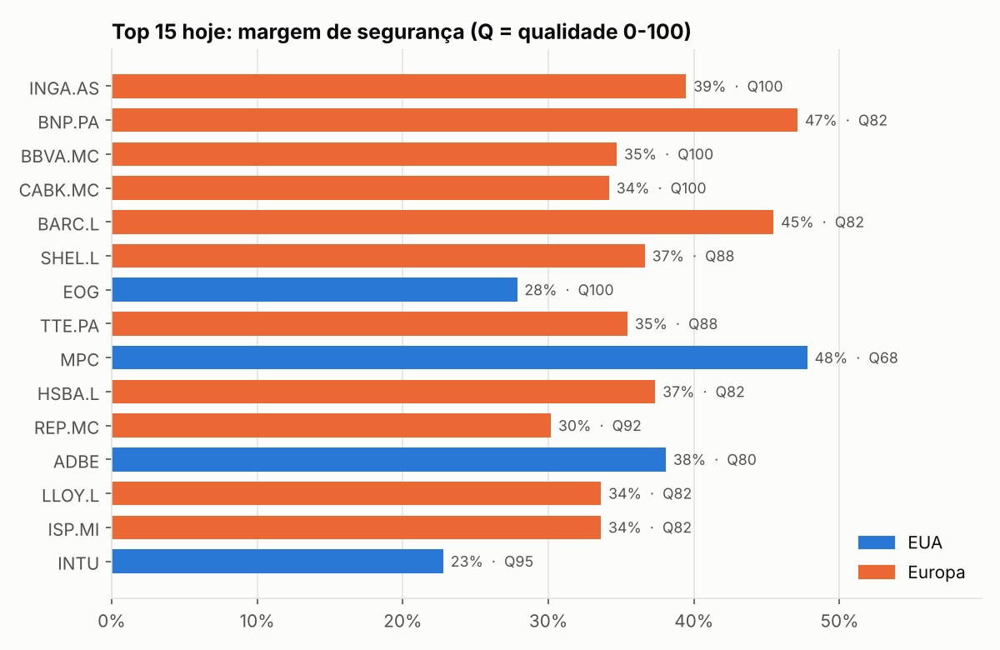
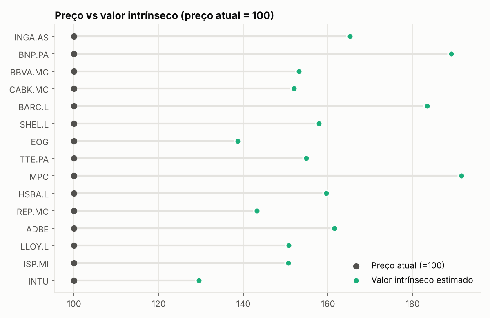
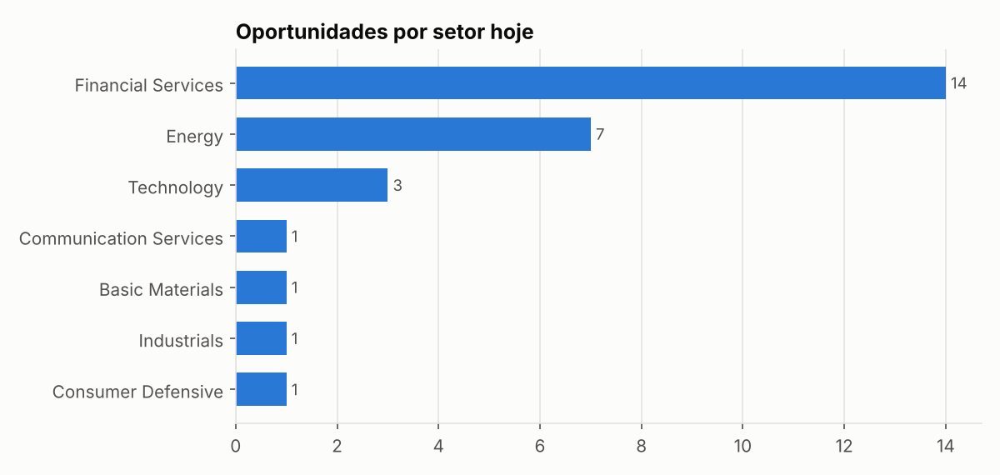
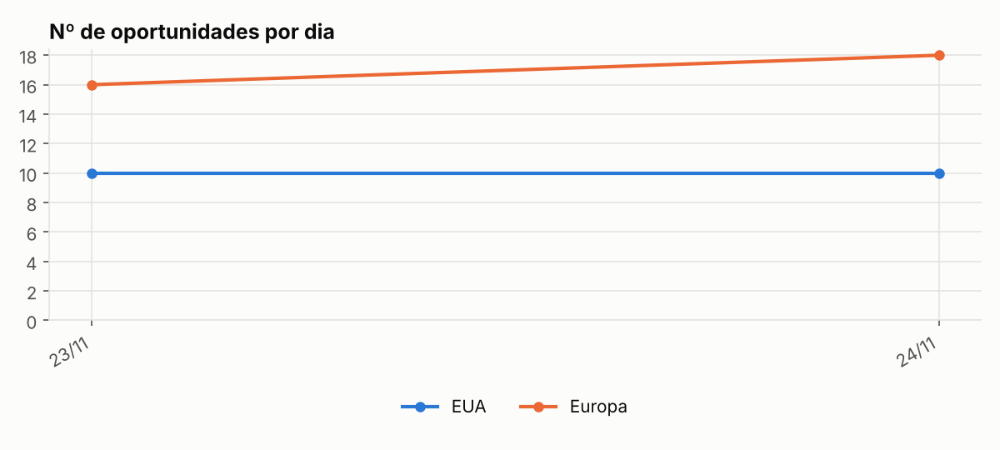
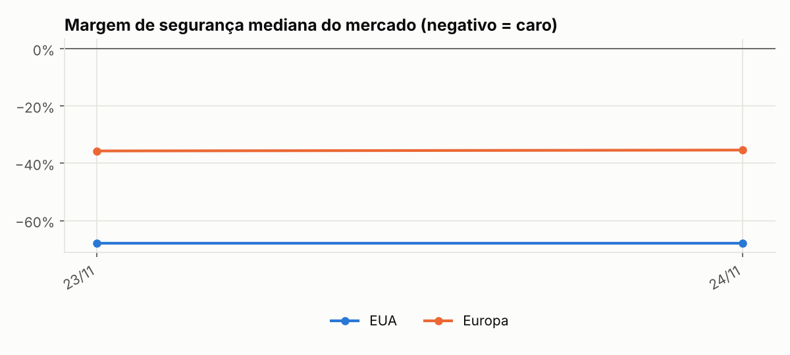
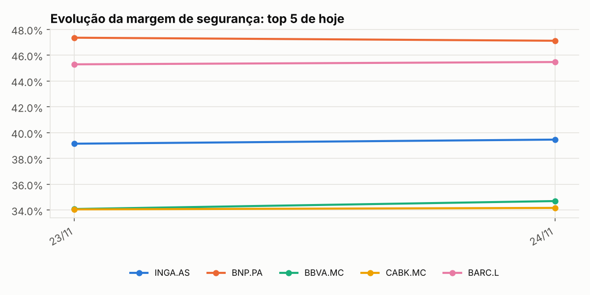
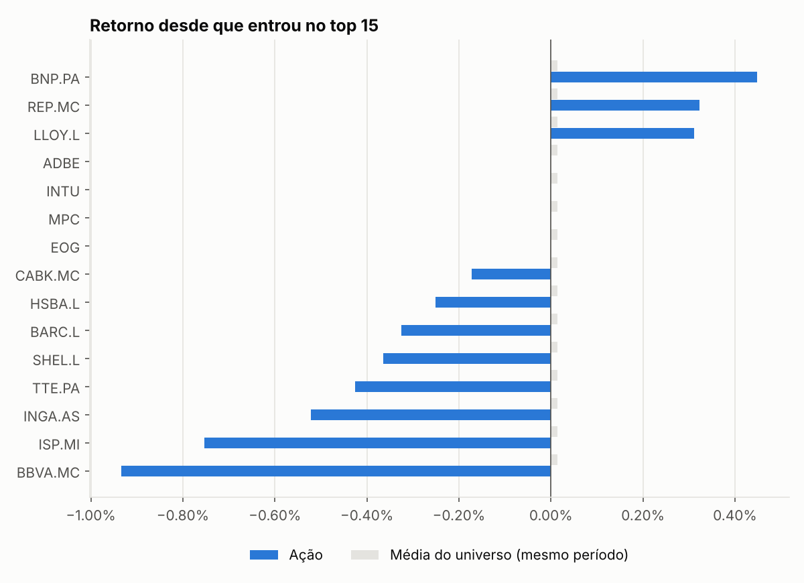

# Painel de oportunidades em bolsa

Atualizado em **2026-11-24** · 2 dia(s) de histórico · [relatório do dia](latest.md) · dados em [`daily_summary.csv`](daily_summary.csv), [`performance.csv`](performance.csv), [`history.csv`](history.csv)

| Indicador | Hoje |
|---|---|
| Ações analisadas | 279 |
| Oportunidades (EUA / Europa) | 28 (10 / 18) |
| Lista de observação | 13 |
| Margem média do top 15 | 36% |
| Qualidade média do top 15 | 88/100 |
| Margem mediana do mercado EUA / Europa | -68% / -35% |

## Hoje

## Ao longo do tempo

## Desempenho das escolhas

Retorno em moeda local desde o primeiro dia em que cada ação entrou no top 15, comparado com a média (pesos iguais) das ~280 ações analisadas no mesmo período. Não inclui dividendos.

Média das escolhas: **-0.2%** vs universo **+0.0%** (20% das escolhas acima do universo).

| Ticker | Entrou em | Preço entrada | Preço atual | Retorno | Universo | Diferença | Ainda no top 15 |
|---|---|---|---|---|---|---|---|
| BNP.PA | 2026-11-23 | 91.48 EUR | 91.89 EUR | +0.4% | +0.0% | +0.4% | sim |
| REP.MC | 2026-11-23 | 27.82 EUR | 27.91 EUR | +0.3% | +0.0% | +0.3% | sim |
| LLOY.L | 2026-11-23 | 96.36 GBp | 96.66 GBp | +0.3% | +0.0% | +0.3% | sim |
| INTU | 2026-11-23 | 275.46 USD | 275.46 USD | +0.0% | +0.0% | -0.0% | sim |
| MPC | 2026-11-23 | 357.69 USD | 357.69 USD | +0.0% | +0.0% | -0.0% | sim |
| EOG | 2026-11-23 | 145.34 USD | 145.34 USD | +0.0% | +0.0% | -0.0% | sim |
| ADBE | 2026-11-23 | 223.98 USD | 223.98 USD | +0.0% | +0.0% | -0.0% | sim |
| CABK.MC | 2026-11-23 | 11.62 EUR | 11.60 EUR | -0.2% | +0.0% | -0.2% | sim |
| HSBA.L | 2026-11-23 | 1,274.00 GBp | 1,270.80 GBp | -0.3% | +0.0% | -0.3% | sim |
| BARC.L | 2026-11-23 | 411.75 GBp | 410.41 GBp | -0.3% | +0.0% | -0.3% | sim |
| SHEL.L | 2026-11-23 | 3,567.00 GBp | 3,554.00 GBp | -0.4% | +0.0% | -0.4% | sim |
| TTE.PA | 2026-11-23 | 77.49 EUR | 77.16 EUR | -0.4% | +0.0% | -0.4% | sim |
| INGA.AS | 2026-11-23 | 27.81 EUR | 27.66 EUR | -0.5% | +0.0% | -0.5% | sim |
| ISP.MI | 2026-11-23 | 5.84 EUR | 5.79 EUR | -0.8% | +0.0% | -0.8% | sim |
| BBVA.MC | 2026-11-23 | 22.50 EUR | 22.29 EUR | -0.9% | +0.0% | -0.9% | sim |

> Triagem quantitativa automática, não é recomendação de investimento.